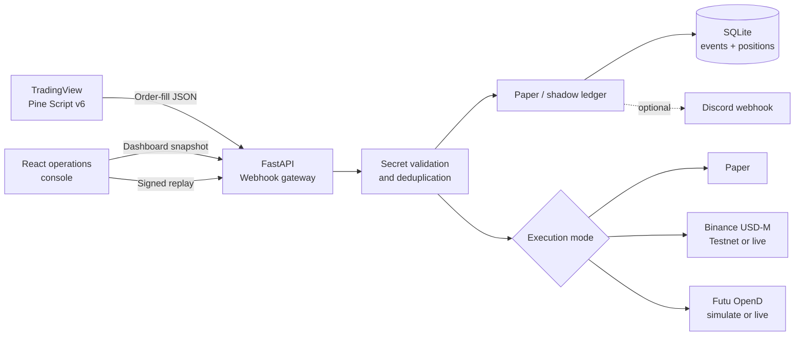

# PineFlow v6

PineFlow is a portfolio-ready TradingView automation project. It includes Pine
Script v6 ORB and multi-timeframe ICT strategies plus a FastAPI webhook gateway
with paper, Binance USDⓈ-M Futures, and Futu OpenD execution adapters. A React
operations console makes execution state, inventory, PnL, and the complete
webhook path inspectable from one screen.

> Paper mode is the default. External adapters use Binance Futures Testnet or
> Futu simulated trading until `PINEFLOW_LIVE_TRADING_ENABLED=true` is set
> explicitly. This is educational software, and backtest results are not a
> promise of future performance.

## Demo evidence


## What it demonstrates

- Pine Script v6 ORB and deterministic ICT/FVG strategy development
- Confirmed 4H context, 15m setup, and 1m execution logic
- ATR-based position sizing, partial exits, and session controls
- Versioned TradingView order-fill JSON with entry/exit intent
- Shared-secret validation and idempotent event processing
- Paper/shadow-position accounting for adds, reductions, closes, and reversals
- Decimal-based quantity, average-price, and realized-PnL calculations
- Optional Binance USDⓈ-M Futures and Futu OpenD order routing
- SQLite persistence, optional Discord notifications, Docker, tests, and CI
- React/TypeScript operations console with a signed signal replay workflow

## Operations console

The console is a real client of `GET /api/v1/dashboard` and the existing
TradingView webhook endpoint. It provides:

- execution-mode and live-trading visibility;
- aggregate gross exposure, realized PnL, event count, and active positions;
- current inventory and recent accepted event views;
- an execution-path visualization from TradingView through broker routing;
- a signal composer that still requires the server-side webhook secret; and
- an explicitly labelled presentation dataset when the API is unavailable.

Docker builds the frontend and serves it from FastAPI at
[http://localhost:8000/dashboard/](http://localhost:8000/dashboard/). For the
separate frontend development workflow, see
[`docs/operations-console.md`](docs/operations-console.md).

## Architecture



## Quick start

1. Set a webhook secret:

   ```bash
   cp .env.example .env
   # Edit PINEFLOW_WEBHOOK_SECRET in .env.
   ```

2. Start the API:

   ```bash
   docker compose up --build
   ```

   If the Docker Compose plugin is unavailable:

   ```bash
   docker build -t pineflow-v6 .
   docker run --rm -p 8000:8000 \
     -e PINEFLOW_WEBHOOK_SECRET='replace-with-your-secret' \
     -e PINEFLOW_DATABASE_PATH=/app/data/pineflow.db \
     -v pineflow-data:/app/data \
     pineflow-v6
   ```

3. Confirm it is healthy:

   ```bash
   curl http://localhost:8000/health
   ```

   Open the operations console at
   [http://localhost:8000/dashboard/](http://localhost:8000/dashboard/).

4. Send the sample fill after replacing the secret:

   ```bash
   curl -X POST http://localhost:8000/api/v1/webhooks/tradingview \
     -H 'Content-Type: application/json' \
     --data @examples/sample-alert.json
   ```

5. Inspect the paper ledger:

   ```bash
   curl http://localhost:8000/api/v1/positions
   curl 'http://localhost:8000/api/v1/events?limit=20'
   ```

Interactive API documentation is available at
[http://localhost:8000/docs](http://localhost:8000/docs).

## TradingView strategies

The original strategy lives at
[`pine/pineflow_orb_strategy.pine`](pine/pineflow_orb_strategy.pine) and uses:

- a configurable opening range and trading session;
- confirmed local-bar breakouts;
- fast/slow EMA, DMI/ADX, and confirmed higher-timeframe EMA filters;
- ATR-derived stops and equity-risk position sizing;
- two 50% take-profit orders;
- maximum daily loss, maximum drawdown, and daily trade limits;
- optional flattening when the trading session ends;
- an on-chart status dashboard.

The ICT strategy lives at
[`pine/pineflow_ict_fvg_strategy.pine`](pine/pineflow_ict_fvg_strategy.pine).
It implements a deterministic version of the workflow in the reference:

- confirmed 4H EMA bias and expansion/pullback state;
- the latest confirmed three-candle 4H fair value gap;
- a 15m FVG touch, liquidity sweep, and MSS or CISD confirmation;
- a retrace into the confirmed 15m FVG;
- a 1m liquidity sweep followed by a 1m FVG and MSS/CISD break;
- a sweep-based stop and opposing 15m liquidity target with an R fallback.

Run the ICT strategy on a one-minute chart. See
[`docs/ict-strategy.md`](docs/ict-strategy.md) for the exact objective
definitions used for the otherwise discretionary ICT terms.

See [`docs/tradingview-setup.md`](docs/tradingview-setup.md) for alert setup and
[`docs/backtest-methodology.md`](docs/backtest-methodology.md) before interpreting
any Strategy Tester output.

## Webhook contract

TradingView fills are expressed as signed inventory changes:

- `buy` adds to a long, reduces a short, or reverses from short to long.
- `sell` adds to a short, reduces a long, or reverses from long to short.

Example:

```json
{
  "secret": "replace-with-your-secret",
  "version": "2",
  "event_id": "pineflow-ict-v1-BTCUSDT-1-ICT-Long-2026-07-24T01:00:00Z",
  "strategy_id": "pineflow-ict-v1",
  "symbol": "BTCUSDT",
  "timeframe": "1",
  "action": "buy",
  "quantity": 2,
  "price": 100,
  "timestamp": "2026-07-24T01:00:00Z",
  "order_id": "ICT Long",
  "intent": "entry"
}
```

`event_id` is the idempotency key. Resending the same event returns
`"status": "duplicate"` without applying the fill again.

`intent` is `entry` or `exit`. Binance uses it to make exit orders
`reduceOnly` in one-way position mode.

## Broker execution

`PINEFLOW_EXECUTION_MODE` accepts:

| Mode | `live=false` | `live=true` |
| --- | --- | --- |
| `paper` | Local simulation | Local simulation |
| `binance_futures` | Binance Futures Testnet | Binance USDⓈ-M live |
| `futu` | Futu simulated account | Futu real account |

Install only the adapter needed for local development:

```bash
python -m pip install -e '.[binance]'
# or
python -m pip install -e '.[futu]'
```

Keep `PINEFLOW_LIVE_TRADING_ENABLED=false` until testnet/simulated orders,
symbol mapping, quantity steps, account mode, and reconciliation have all been
verified. Complete setup and limitations are documented in
[`docs/broker-execution.md`](docs/broker-execution.md).

## API

| Method | Path | Purpose |
| --- | --- | --- |
| `GET` | `/health` | Liveness and execution mode |
| `GET` | `/api/v1/dashboard` | Aggregated operations snapshot for the console |
| `POST` | `/api/v1/webhooks/tradingview` | Validate and apply a paper fill |
| `GET` | `/api/v1/positions` | Current paper positions and realized PnL |
| `GET` | `/api/v1/events?limit=50` | Recent accepted fill events |

## Local development

Python 3.11 or newer is required.

```bash
python -m venv .venv
source .venv/bin/activate
python -m pip install -e '.[dev]'
ruff check .
ruff format --check .
pytest
```

Run the API without Docker:

```bash
export PINEFLOW_WEBHOOK_SECRET='replace-with-a-long-random-secret'
uvicorn app.main:app --reload
```

Run the console with hot reload in another terminal:

```bash
cd ui
npm ci
npm run dev
```

The Vite development server proxies `/api` and `/health` to port `8000`.

## Repository layout

```text
pineflow-v6/
├── app/                    # FastAPI, ledger, execution adapters, notifier
├── ui/                     # React/TypeScript operations console
├── pine/                   # ORB and ICT Pine Script v6 strategies
├── tests/                  # Unit and API tests
├── examples/               # Replayable webhook payload
├── docs/                   # Setup and backtest methodology
├── Dockerfile
├── docker-compose.yml
└── pyproject.toml
```

## Roadmap

- Broker order-status reconciliation and fill-stream consumers
- Paper account equity and unrealized PnL
- Prometheus metrics and structured audit logs
- Golden-file comparison against exported TradingView trades

## License

MIT. See [`LICENSE`](LICENSE).
